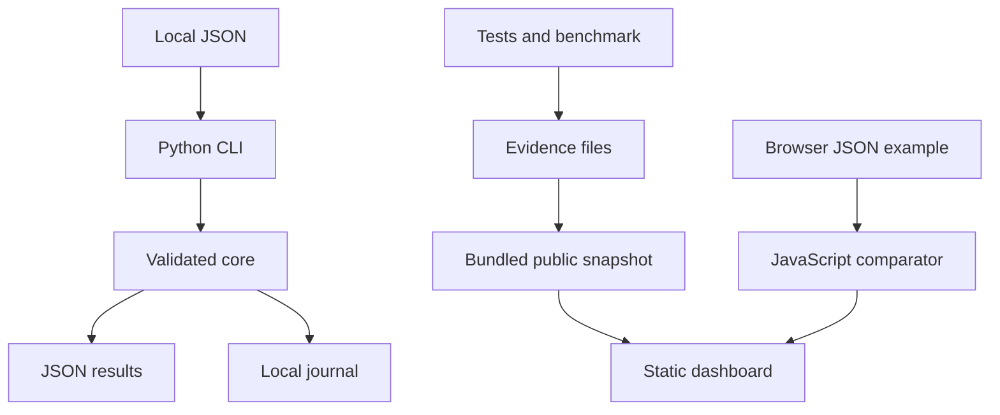

# Evidence Engine: one-page design brief

**Problem.** Make local engineering claims inspectable: valid dependencies,
comparable evaluations and journals whose byte consistency can be checked.
This document describes the public prototype, not the official challenge.

**Inputs and outputs.** Local JSON tasks/durations or paired case results enter
a CLI. Outputs are JSON metrics or explicit errors. Local events enter a
single-writer JSONL journal. A public static dashboard reads a bundled evidence
snapshot and offers a separately implemented browser comparator.

**Decisions.** Standard-library core reduces setup and credentials; optional
NumPy arrays are separate. Heap-based Kahn traversal avoids repeated scans;
critical path assumes unlimited workers and is not resource scheduling. Paired
case identifiers prevent denominator changes. Single-writer journal avoids a
database but provides no concurrency or transaction guarantee. Static hosting
limits attack surface but cannot execute Python or authenticate a team API.

**Measurement.** Regressions cover invalid inputs, numeric overflow, journal
changes, CLI subprocesses, seeded DAGs, browser parity and manifest checks.
Benchmark timings are workload-specific. External adoption, hidden-test scores,
production reliability and independent review are not established.

**Excluded.** Autonomous agents, independent AI protectors, model training,
payment handling, official challenge contract and a service API. Source code,
tests and validation evidence are public; the private Río corpus is excluded.
